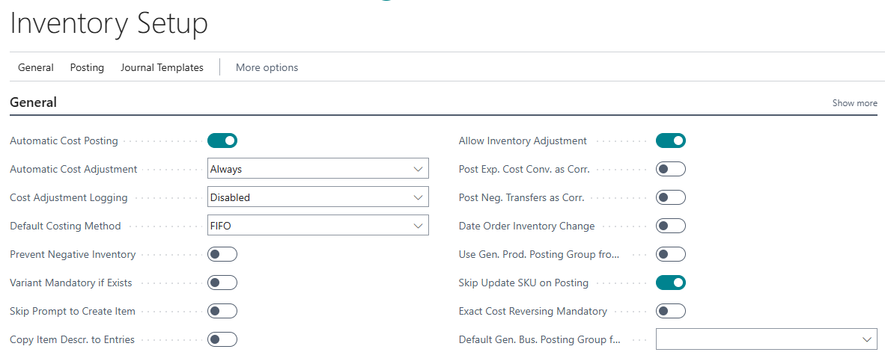

# Skip update SKU on posting in the Czech version

The standard functionality updates the **Last Direct Cost** field on the **Stockkeeping Unit Card** page when the stockkeeping unit is posted. The **Skip Update SKU on Posting** functionality allows you to disable the update.

## Inventory setup

To skip the update of stockkeeping units, turn on **Skip Update SKU on Posting** toggle on the **Inventory Setup** page.

## Related information

[Advanced Localization Pack for Czech](ui-extensions-advanced-localization-pack-cz.md)  
[Czech Local Functionality](czech-local-functionality.md)  

[!INCLUDE[footer-include](../../includes/footer-banner.md)]
