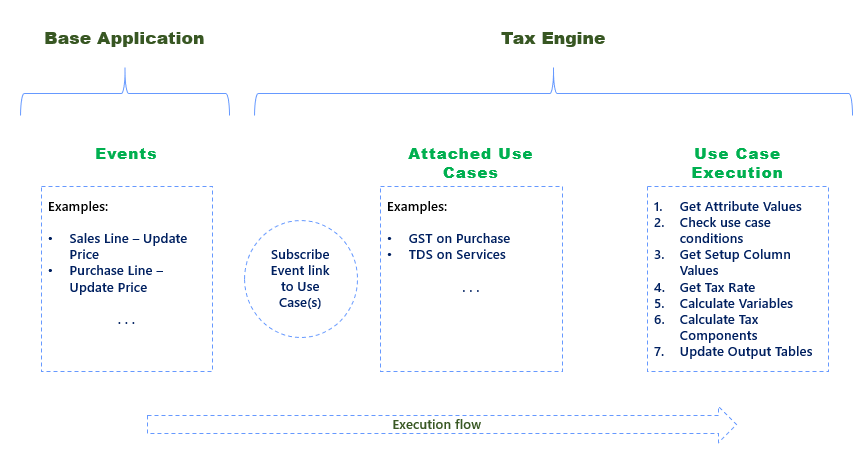

# Tax engine - Design consideration

Consider the following design choices when you configure taxes with the tax engine.

## Choose a tax type

Create a separate tax type when it has unique attributes used in conditions and calculation logic. For example, GST and TDS are different tax types.

## Design tax attributes

- **Use a generic attribute**:
   Generic attributes are used in the same way as item attributes are managed in Business Central. If the attribute isn't linked to a field in an existing table, then it's generic in nature.

- **Map an attribute to a table field**:
   In case field is already available in the table, which is being mapped then it can be linked to that attribute. This means that field data is used as attribute value.

## Design tax rate setup

- **Configure rate columns for each tax type**:
  
  Configure the rate setup separately for each tax type. The pages are shared, but the columns are based on each tax type's rate column setup. For example, GST can use HSN Code, whereas TDS doesn't depend on HSN codes.

- **Use shared tax rate storage**:
  
  Tax types use shared tables for tax rates and rate values. You can configure columns to reflect changes to components or other rate parameters.
  
  Example: If there's a regulatory change in which ‘Threshold Limit’ is removed then it can be managed by removing it from the tax rate column setup.

## Understand stored tax values

- **Tax transaction values**:

  Data pertaining to tax calculation regarding a said transaction is stored in a common table. If the transaction record is deleted, then related tax transaction value also gets deleted.
  
  Example: If transaction involves ‘Purchase Line’ then all information related to tax calculation is stored in tax transaction value. If purchase line is deleted, then tax transaction value record related to that purchase line is also deleted.
  
  The **Tax Information** FactBox shows tax attributes and calculated components for the transaction. Only values configured as visible on the interface appear in the FactBox.

- **Tax rate values**:

  This table contains information of tax rate setup. Tax engine uses common tax rate setup for different types of taxes.

## Plan use case execution

- **Leaf use cases calculate output**:

  Use cases can have a parent-child relationship. Parent use cases can define attribute and rate column mappings shared by their children. Component percentages, computation scripts, and component formulas run for leaf use cases, which have no children.
  
  A child use case is mapped in the use case tree. Before execution of the use case, conditions of use case tree should be passed.
  
- **Sequence use case execution**:

  The sequence of use case execution depends on the sequencing defined in the use case tree.

- **Choose the applicable use case**:

  The tax engine checks use cases in tree order. A use case must be enabled and meet its conditions. After a leaf use case calculates output for a tax type, later use cases for that tax type aren't executed in the same calculation. Don't design the tree on the assumption that every matching use case for a tax type will run.

- **Review the execution flow**:

  The diagram gives a high-level view of calculation. The use case tree and its conditions determine which use case runs.

  

## Deploy and update configuration

- **Configuration files**:

  You can export and import use case configuration as JSON files. Deploy configuration separately for each company.

- **Deploy configuration**:

  In a production company, use **Set up Tax Engine** in **Assisted Setup** to import the configuration supplied by the installed tax extensions. The extensions provide configuration through setup codeunits. For example, GST setup reads JSON from extension resources. To transfer custom or modified configuration, use the import and export actions on the **Tax Types** and **Use Cases** pages.

- **Import updated configuration**:

  Importing an update can replace an existing use case. The tax engine archives a released use case when it changes to **Draft**, including during replacement by an import. Manual imports and supplied configuration updates handle version numbers differently. Don't assume that each import increases the major version.

- **Distribute custom changes**:

  In case of any change done in any use case to fix a bug or handle regulatory change, the updated configuration should be imported again in each company individually.

- **Manage versions**:

  Changing a released use case to **Draft** archives its previous configuration, increases the minor version, and disables the use case. Set **Status** to **Released** before enabling the revised use case. Use **Archived Logs** to review archived versions.

## Enabling and disabling configuration

- **Enable or disable a use case**:

  Imported use cases are released and enabled. Disable any use cases that don't apply to your business. The tax type must also be enabled for a use case to run.

## Related information

[Overview](TaxEngine-001-Overview.md)

[!INCLUDE[footer-include](../../includes/footer-banner.md)]
