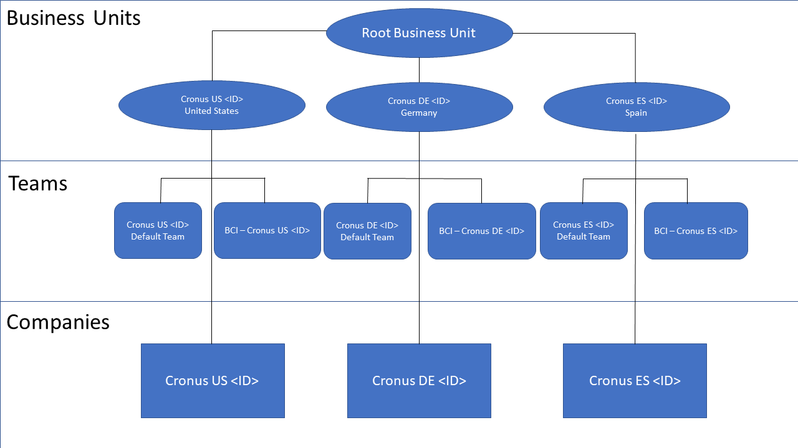
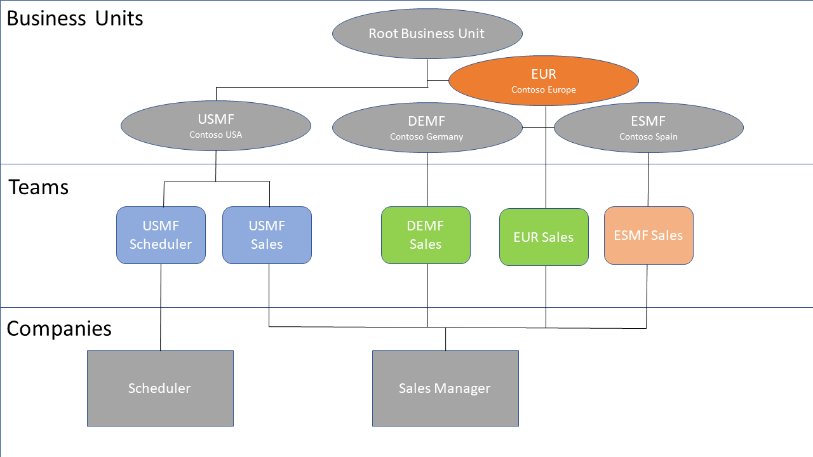

# Data ownership models for synchronization

[!INCLUDE[prod_short](includes/cds_long_md.md)] requires that you specify an owner for the data you store. For more information, see [Types of tables](/powerapps/maker/data-platform/types-of-entities) in the Power Apps documentation. When you set up integration between [!INCLUDE[prod_short](includes/cds_long_md.md)] and [!INCLUDE[prod_short](includes/prod_short.md)] you must choose the **User or team** ownership for records that are synchronized. Actions that can be performed on these records can be controlled on a user level. <!--We recommend the Team ownership model because it makes it easier to manage ownership for multiple people.NO LONGER TRUE IN DATAVERSE-->

## Team Ownership
In [!INCLUDE[prod_short](includes/prod_short.md)], a company is a legal and business table that offers ways to secure and visualize business data. Users always work in the context of a company. The closest that [!INCLUDE[prod_short](includes/cds_long_md.md)] comes to this concept is the business unit table, which does not have legal or business implications.

Because business units lack legal and business implications, you cannot force a one-to-one (1:1) mapping to synchronize data between a company and a business unit, either one-way or bi-directional. To make synchronization possible, [!INCLUDE[prod_short](includes/prod_short.md)] creates the following records in [!INCLUDE[prod_short](includes/cds_long_md.md)] when you enable synchronization for a company, if the records don't already exist:

* A company record that corresponds to the company in [!INCLUDE[prod_short](includes/prod_short.md)].
* A default business unit whose name includes the company name and company ID. For example, Cronus International Ltd. (00aa00aa-bb11-cc22-dd33-44ee44ee44ee).
* A separate owner team associated with the business unit. The team uses the business unit's name with the prefix "BCI -." For example, BCI - Cronus International Ltd. (00aa00aa-bb11-cc22-dd33-44ee44ee44ee).

Records that are created and synchronized to [!INCLUDE[prod_short](includes/cds_long_md.md)] are assigned to the owner team that is linked to the business unit.

> [!NOTE]
> If you rename a company in [!INCLUDE[prod_short](includes/prod_short.md)], the names of the automatically created company, business unit, and team in [!INCLUDE[prod_short](includes/cds_long_md.md)] aren't updated. Because only the company ID is used for integration, this doesn't affect synchronization. If you want the names to match, you must update the company, business unit, and team in [!INCLUDE[prod_short](includes/cds_long_md.md)].

The following image shows an example of this data setup in [!INCLUDE[prod_short](includes/cds_long_md.md)].

In this configuration, records that are related to the Cronus US company will be owned by a team that is linked to the Cronus US business unit in [!INCLUDE[prod_short](includes/cds_long_md.md)]. Users who can access that business unit through a security role that is set to business unit–level visibility in [!INCLUDE[prod_short](includes/cds_long_md.md)] can now see those records. The following example shows how to use teams to provide access to those records.

* The Sales Manager role is assigned to members of the Cronus US Sales team.
* Users who have the Sales Manager role can access account records for members of the same business unit.
* The Cronus US Sales team is linked to the Cronus US business unit that was mentioned earlier. Members of the Cronus US Sales team can see any account that is owned by the Cronus US user, which would have come from the Cronus US company table in [!INCLUDE[prod_short](includes/prod_short.md)].

However, the 1:1 mapping between business unit, company, and team is just a starting point, as shown in the following image.

In this example, a new EUR (Europe) root business unit is created in [!INCLUDE[prod_short](includes/cds_long_md.md)] as the parent for both Cronus DE (Germany) and Cronus ES (Spain). The EUR business unit is not related to synchronization. However, it can give members of the EUR Sales team access to account data in both Cronus DE and Cronus ES by setting the data visibility to **Parent/Child BU** on the associated security role in [!INCLUDE[prod_short](includes/cds_long_md.md)].

Synchronization determines which team should own records. This is controlled by the **Default owning team** field on the BCI row. When a BCI record is enabled for synchronization, [!INCLUDE[prod_short](includes/prod_short.md)] automatically creates the associated business unit and owner team if they don't already exist, and sets the **Default owning team** field. When synchronization is enabled for a table, administrators can change the owning team, but a team must always be assigned.

> [!NOTE]
> Records become read-only after a company is added and saved, so be sure to choose the correct company.

## Choosing a different business unit
You can change the business unit selection if you are using the Teams ownership model. If you use the Person ownership model, the default business unit is always selected. 

If you choose another business unit, for example, one that you created earlier in [!INCLUDE[prod_short](includes/cds_long_md.md)], it will keep its original name. That is, it will not be suffixed with the company ID. If a matching team doesn't already exist, [!INCLUDE[prod_short](includes/prod_short.md)] creates one using the team naming convention.

When changing a business unit, you can choose only the business units that are one level below the root business unit.

## Person Ownership
If you choose the Person ownership model you must specify each salesperson who will own new records. The business unit and team are created as described in the [Team Ownership](admin-cds-company-concept.md#team-ownership) section.

The default business unit is used when the Person ownership model is chosen, and you cannot choose another business unit. The team that is associated with the default business unit will own records for common tables, such as the Product table, that are not related to specific salespersons.

When you couple salespersons in [!INCLUDE[prod_short](includes/prod_short.md)] to users in [!INCLUDE[prod_short](includes/cds_long_md.md)], [!INCLUDE[prod_short](includes/prod_short.md)] will add the user to the default team in [!INCLUDE[prod_short](includes/cds_long_md.md)]. You can verify that users are added by looking at the **Default Team Member** column on the **Users - Common Data Service** page. If the user is not added, you can add them manually by using the **Add Coupled Users to Team** action. For more information, see [Synchronizing Data in Business Central with Dataverse](admin-synchronizing-business-central-and-sales.md).

## Related information
[About [!INCLUDE[prod_short](includes/cds_long_md.md)]](admin-common-data-service.md)

[!INCLUDE[footer-include](includes/footer-banner.md)]
